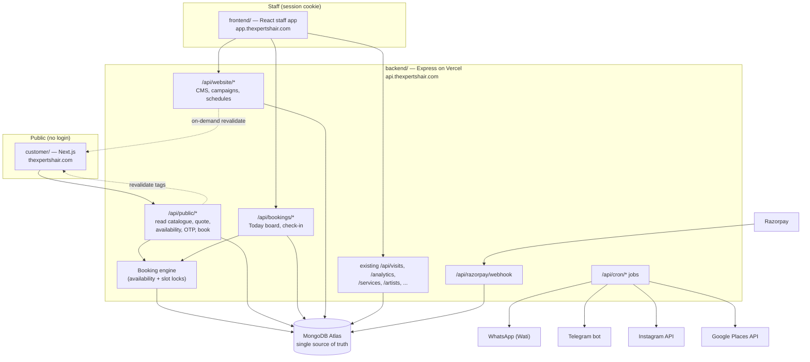
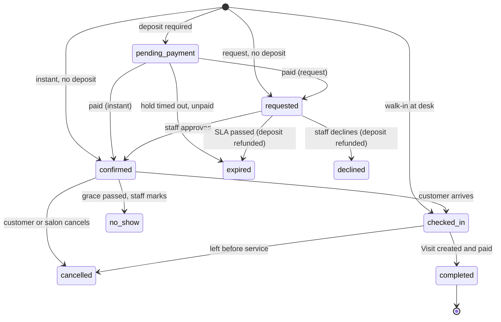
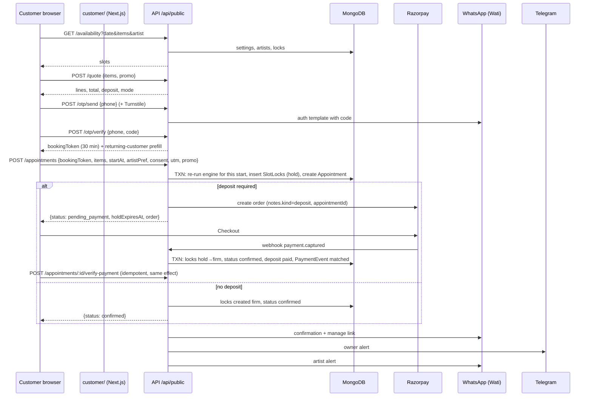

# CONTROL_FLOW_AND_DATA_LOGIC.md

How the customer website, booking engine, staff app and payments work together.
Every backend change for the customer platform must match this document. If you need
to deviate, update this file and the Decisions table (§24) in the same PR.

Status: v1, 13 Oct 2026. Based on repo commit `d2adb97`.

---

## 1. Architecture



### 1.1 Domains and request paths

| Caller | Calls | Auth | Cookies |
|---|---|---|---|
| Customer site (server components) | `https://api.thexpertshair.com/api/public/*` | none | none |
| Customer site (browser, booking sheet) | same, via Next.js rewrite `/api/public/*` → API (same-origin) | short-lived `bookingToken` in body after OTP | none |
| Staff app | `/api/*` via Vercel rewrite to API (existing pattern, avoids Safari ITP) | express-session | `connect.sid`, `salon_device` |
| Razorpay | `/api/razorpay/webhook` | HMAC signature | none |
| Vercel Cron | `/api/cron/*` | `Authorization: Bearer $CRON_SECRET` | none |

CORS: add `https://thexpertshair.com`, `https://www.thexpertshair.com`,
`https://app.thexpertshair.com` to `ALLOWED_ORIGINS`. Public routes do not need
`credentials`.

---

## 2. Data model

Notation: `?` = optional. All dates are UTC `Date`. Money is whole rupees (`Number`).

### 2.1 Changes to existing models

**Service** (`backend/models/Service.js`) — add public layer. Internal fields unchanged.

| Field | Type | Notes |
|---|---|---|
| `publicPrice` | Number | What the customer pays. Migration M3 sets `round(price × 0.5)`; owner reviews exceptions |
| `showOnWebsite` | Boolean, default false | Curated menu. Typos and "Any item" never get this |
| `slug` | String, unique sparse | URL key |
| `publicName` | String? | Clean name, e.g. "Smoothening" instead of "Smoothening (Women) Medium" |
| `audience` | `her` \| `him` \| `unisex` | Drives For her / For him tabs |
| `displayCategory` | String | Normalised: Hair, Colour, Treatments, Skin, Waxing, Threading, Hands & feet, Makeup, Grooming |
| `variantGroup` | String? | Services sharing a group show as ONE public card with a selector |
| `variantLabel` | String? | "Short", "Medium", "Long" |
| `addOnIds` | [ObjectId] | Other services offered as add-ons (they are real services, so they bill normally) |
| `shortDescription`, `description` | String? | |
| `images` | [String] | URLs |
| `durationMinutes` | Number | Exists. REQUIRED when `bookingMode = instant` |
| `durationConfirmed` | Boolean | false = the 60-min estimate (D11). Booking uses `durationMinutes` either way; Visits snapshot `duration` for artist time-performance ONLY when true (D14) |
| `bufferMinutes` | Number, default 0 | Cleanup time after the service |
| `bookingMode` | `instant` \| `request` \| `walkin_only` \| `hidden` | Default `hidden` |
| `requiresConsultation` | Boolean | Forces `request` |
| `requiresPatchTest` | Boolean | Colour services. Shown as badge; checked against `Customer.patchTestDoneAt` |
| `depositAmount` | Number, default 0 | Per-service deposit rule |
| `resourceIds` | [ObjectId] | Facial bed, pedicure station, makeup chair, etc. |
| `featured`, `sortOrder` | Boolean, Number | Landing page ordering |
| `seo` | `{title?, description?}` | |

Why variants are separate existing services and not price options: the catalogue
already has "Smoothening (Women) Short/Medium/Long" as separate services. Grouping them
keeps every booked item a real `serviceId`, so Visits, analytics and artist attribution
work unchanged.

**Artist** (`backend/models/Artist.js`)

| Field | Type | Notes |
|---|---|---|
| `skills` | [ObjectId → Service] | Services this artist can perform. Empty = cannot be booked online |
| `gender` | `female` \| `male` \| `other`? | Only used for the optional "female artist" filter |
| `level` | `senior` \| `stylist` \| `junior`? | Display only in v1 |
| `onlineBookable` | Boolean, default false | Master switch |
| `onlineShare` | Number 0–100, default 100 | Max % of the artist's working minutes per day sellable online. Barbers start at 0–40 |
| `schedule.weekly` | `{mon..sun: [{start:"HH:mm", end:"HH:mm"}]}` | IST wall-clock |
| `schedule.breaks` | `[{day, start, end}]` | |
| `publicProfile` | `{slug, displayName, bio, specialties[], photo, portfolio[], instagram, sortOrder, visible}` | |

**Visit** (`backend/models/Visit.js`)

| Field | Type | Notes |
|---|---|---|
| `customerId` | ObjectId? | Set on every new visit (desk lookup by phone) |
| `appointmentId` | ObjectId? | Set when created from a booking or walk-in record |
| `source` | `{channel: web\|desk\|phone\|whatsapp\|walkin, utm?{source,medium,campaign,content}, campaignId?, promoCode?}` | Attribution |
| `services[].listPrice` | Number? | Snapshot of `Service.price` for online-origin visits |
| `depositAmount` | Number, default 0 | Already-received online money |
| `depositPaymentId` | String?, unique sparse | Razorpay id of the deposit |
| `discountReason` | String? | `campaign:<slug>`, `promo:<code>`, `desk` |
| `giftCardAmount` | Number, default 0 | Phase 1.5. Joins the payment invariant |
| `giftCardRedemptions` | `[{giftCardId, amount}]` | Phase 1.5 |

**PaymentEvent** (`backend/models/PaymentEvent.js`)

| Field | Type | Notes |
|---|---|---|
| `purpose` | `visit` \| `deposit` \| `giftcard` | From Razorpay order `notes.kind` |
| `appointmentId` | ObjectId? | Deposits |
| `giftCardId` | ObjectId? | Gift card sales |
| `reconcileStatus` | add `matched_appointment`, `matched_giftcard` | |

**User permissions** (`backend/constants/permissions.js`) — see §19.

### 2.2 New models

**Customer**

| Field | Type | Notes |
|---|---|---|
| `phone` | String, unique | 10-digit Indian mobile |
| `name` | String | Latest known |
| `gender` | `female`\|`male`\|`other`\|`prefer_not`? | Of this person, not the booker |
| `email` | String? | |
| `householdId` | ObjectId? | Links family members booked together |
| `preferredArtistId` | ObjectId? | |
| `patchTestDoneAt` | Date? | The only health-adjacent field allowed |
| `marketing` | `{whatsappOptIn: Boolean, at?, source?}` | Unticked by default |
| `policyAcceptedAt`, `policyVersion` | Date?, String? | |
| `stats` | `{visits, lastVisitAt, firstVisitAt, noShows, lateCancels}` | Maintained by hooks + nightly job |
| `firstTouch` | `{utm?, at}` | |
| `createdFrom` | `backfill` \| `web` \| `desk` | |

**Appointment** — a booking OR a walk-in. Walk-ins are appointments with
`source.channel = walkin` created directly in `checked_in`. This keeps the Today board
and slot locks on one model.

```js
{
  ref: "EXP-7K3Q9",                 // human code, unique
  mode: "instant" | "request",
  status: "pending_payment" | "requested" | "confirmed" | "checked_in" |
          "completed" | "cancelled" | "declined" | "expired" | "no_show",
  customerId, contact, name,        // the booker
  guests: [{
    guestKey: "g1",
    name, gender, customerId?,      // guest's own customer record if phone given
    items: [{
      serviceId, name, publicPrice, listPrice,
      durationMin, bufferMin,
      artistId, artistName,
      startAt, endAt,               // service window, excluding buffer
      resourceIds: []
    }]
  }],
  startAt, endAt,                   // whole appointment, including buffers
  pricing: { subtotal, discount, total, promoCode?, packageId?, campaignId? },
  deposit: { required: Boolean, kind: "deposit"|"full" (D18), amount, status: "none"|"pending"|"paid"|
             "refunded"|"forfeited"|"applied", razorpayOrderId?, razorpayPaymentId?, paidAt?,
             forfeitable?: Number },     // full payment: the part kept on late cancel / no-show
  holdExpiresAt?, requestExpiresAt?,
  requestedWindow?: { date: "YYYY-MM-DD", window: "morning"|"afternoon"|"evening" }, // §6.1
  preferredArtistId?, preferredArtistName?,   // a wish on a request, not an assignment
  internalNote?,                     // staff-only, never public
  source: { channel, utm?, campaignId?, promoCode? },
  policyVersion, policyAcceptedAt,
  notes?,                            // customer note, max 300 chars
  manageTokenHash,                   // sha256 of the token in the manage link
  rescheduleCount: 0,
  checkedInAt?, visitId?,
  cancelledAt?, cancelledBy?: "customer"|"salon"|"system", cancelReason?,
  createdBy?: userId,                // staff-created bookings
  statusHistory: [{ from, to, at, by, reason }]
}
```

Indexes: `{ref:1}` unique · `{status:1, startAt:1}` · `{customerId:1, startAt:-1}` ·
`{contact:1, status:1}` · `{"guests.items.artistId":1, startAt:1}` · `{holdExpiresAt:1}` · `{requestExpiresAt:1}`.

**SlotLock** — the double-booking guard.

```js
{
  artistId,            // or resourceId for resource locks (see kind)
  kind: "artist" | "resource",
  resourceUnit?: 0,    // for resources with capacity > 1
  blockStart,          // UTC instant aligned to 15-min grid in IST
  appointmentId,
  state: "hold" | "firm",
  expiresAt?           // set only for holds
}
```
Indexes: unique `{kind:1, artistId:1, resourceUnit:1, blockStart:1}` ·
TTL `{expiresAt:1}, expireAfterSeconds: 0` (firm locks have no `expiresAt` and never expire).

**OtpChallenge** `{phoneHash, codeHash, purpose: "booking"|"manage"|"giftcard", attempts, expiresAt (5 min, TTL), consumedAt?, channel: "whatsapp"|"sms"|"dev"}`

**TimeOff** `{artistId, startAt, endAt, reason?, createdBy}`

**Resource** `{name, capacity, serviceIds[], active}`

**SiteSettings** (singleton)

```js
{
  timezone: "Asia/Kolkata",
  requestWindows: { morning: {label, start, end}, afternoon: {...}, evening: {...} }, // Phase 1 (D17)
  openingHours: { mon: [{open:"09:00", close:"20:00"}], ... },
  holidays: ["2026-11-08"], specialHours: [{date, open, close}],
  slotMinutes: 15, minLeadMinutes: 120, horizonDays: 30,
  holdMinutes: 10, requestSlaMinutes: 120,
  cancellationCutoffHours: 24, maxActiveBookingsPerPhone: 3, maxGuests: 4,
  maxOnlineReschedules: 2, noShowGraceMinutes: 15,
  deposit: { peakDates: ["2026-10-28","2026-10-29"], peakDayAmount: 200,
             repeatNoShowAmount: 200, repeatNoShowThreshold: 2 },
  policyVersion: "2026-10-v1",
  contact: { phone, whatsapp, mapUrl, address, placeId },
  publicPriceRatio: 0.5
}
```

**Campaign** `{slug, name, status (derived from dates), startsAt, endsAt, audience, placements: ["home_strip","popup","offers_page"], popup?: {trigger: "delay"|"scroll"|"exit", value, frequency: "session"|"day"}, content: {eyebrow, headline, body, image, ctaLabel, ctaHref}, promo?: {code, type: "percent"|"flat", value, serviceIds?, minSpend?, maxUses?, uses, perCustomerLimit?}, utmCampaign}`

**Package** `{slug, name, description, image, items: [serviceId], packagePrice, validFrom, validTo, bookableDates?: [date], capTotal?, capPerDay?, sold, audience, campaignId?}`

**GiftCard** (Phase 1.5) `{codeHash, codeLast4, initialValue, balance, status: "active"|"redeemed"|"expired"|"void", purchaser: {name, phone}, recipient: {name, phone?, message?}, expiresAt (12 months), paymentEventId, redemptions: [{visitId, amount, at, by}]}`. Closed-loop: usable only at this salon.

**Reel** `{igMediaId, mediaType, mediaUrl, thumbnailUrl, permalink, caption, postedAt, visible, serviceId?, sortOrder, urlRefreshedAt}`

**ReviewCache** `{rating, count, reviews: [{author, rating, text, relativeTime, profilePhoto}], fetchedAt, attribution}`

**NotificationLog** `{key (unique), appointmentId?, type, channel, to, status: "sent"|"failed"|"skipped", providerId?, error?, sentAt}`. `key = "<appointmentId>:<type>"` makes every send idempotent.

**PublicEvent** `{sessionId, type, props, utm, path, at}` TTL 180 days, no PII.

**JobRun** `{name (unique), lockedUntil, lastRunAt, lastResult}` — cron overlap guard.

**RateLimitHit** `{key, windowStart, count}` TTL — shared limiter for public routes.

---

## 3. Appointment state machine



| From → To | Who | Side effects |
|---|---|---|
| (new) → pending_payment | customer | hold locks (expires `holdMinutes`), Razorpay order |
| pending_payment → confirmed / requested | webhook or verify-payment | locks: instant → firm; request → hold until `requestExpiresAt` |
| (new) → confirmed | customer, no deposit, instant | firm locks |
| (new) → requested | customer, no deposit, request | hold locks until `requestExpiresAt` |
| requested → confirmed | staff (`bookings.manage`) | locks → firm, WhatsApp "confirmed" |
| requested → declined / expired | staff / cron | delete locks, refund deposit, WhatsApp |
| confirmed → cancelled | customer before cutoff | delete locks, deposit refunded |
| confirmed → cancelled | customer after cutoff | delete locks, deposit forfeited (owner may waive) |
| confirmed → cancelled | salon | delete locks, deposit refunded, WhatsApp apology + rebook link |
| confirmed → no_show | staff after `noShowGraceMinutes` | delete future locks, deposit forfeited, `stats.noShows++` |
| confirmed → checked_in | staff | `checkedInAt`, opens visit entry prefilled |
| checked_in → completed | visit creation | `visitId`, deposit `applied`, `stats.visits++` |

Locks are deleted (not kept) on cancel/decline/expire/no-show so the time becomes
sellable immediately. History lives in `statusHistory`.

---

## 4. Availability engine

Pure function, unit-tested, no I/O inside the core:

```
availability(date, guests[], artistPref?, now) → slots[]
```

### 4.1 Inputs it loads first
1. `SiteSettings` (hours, holidays, special hours, lead time, horizon).
2. Services for all requested items (duration, buffer, skills needed, resources, bookingMode).
3. Candidate artists: `active && onlineBookable && skills ⊇ item.serviceId` (per item).
4. For each candidate artist on `date`: weekly schedule ∩ opening hours − breaks − `TimeOff`.
5. Existing `SlotLock`s for those artists/resources on `date` where `state=firm` OR `expiresAt > now`.
6. Online minutes already sold per artist that day (for `onlineShare`).

### 4.2 Algorithm (one guest)
```
G = 15 min grid
items sorted by service.sortOrder (cut before colour, threading before makeup, etc.)
for t in grid(dayOpen .. dayClose) where t >= now + minLeadMinutes:
    chain = []
    cursor = t
    ok = true
    for item in items:
        need = ceil15(item.durationMin + item.bufferMin)
        artists = eligible(item) ordered by:
                  artistPref match > artist already in chain > fewest booked minutes today > name
        pick first artist a where free(a, cursor, need) and resourcesFree(item, cursor, need)
                                  and onlineShareOK(a, need)
        if none: ok = false; break
        chain.push({item, a, start: cursor, end: cursor + item.durationMin})
        cursor += need
    if ok: emit slot {startAt: t, endAt: cursor, chain}
```
- `free(a, s, n)` = every 15-min block in `[s, s+n)` is inside a's working intervals and has no lock.
- Multiple guests (group booking): run the chain for each guest at the same `t`, with
  locks already claimed by earlier guests in this candidate treated as taken. A slot is
  valid only if every guest gets a chain.
- `artistPref = specific`: items that artist can do MUST use them; other items may use others.
- Slots are returned grouped (morning < 12:00 ≤ afternoon < 16:00 ≤ evening) with
  `remaining` = count of distinct chains at that time (used for honest "2 left").
- `walkin_only` and `hidden` services are rejected. Any `request` item → appointment mode `request`.
- `requiresPatchTest` and customer has no `patchTestDoneAt` within 6 months → earliest
  slot is now + 48h and the confirmation tells them to come in for a patch test.

### 4.3 Performance
5–10 artists × ~45 grid points × ≤ 4 items is tiny; compute on request. Cache the
public response for 30 seconds per `(date, items, artistPref)` key.

---

## 5. Online booking flow (instant)



### 5.1 The create transaction (exact order)
1. Verify `bookingToken` (HMAC, not expired, phone matches).
2. Load settings; enforce `maxActiveBookingsPerPhone` and no overlap with this phone's
   other active appointments.
3. Re-run the engine for the requested `startAt` only. If no chain → `409 SLOT_TAKEN`
   with the 3 nearest alternatives.
4. Recompute the quote server-side (ignore any price from the browser). Validate promo/package caps.
5. `session.withTransaction`:
   a. delete expired holds overlapping the target blocks (TTL lag protection);
   b. `insertMany` SlotLocks for every block of every chain item (artist + resource);
      duplicate-key → abort → `409 SLOT_TAKEN`;
   c. create Appointment;
   d. increment package `sold` / promo `uses` with conditional update (cap check); fail → abort.
6. After commit: create Razorpay order if deposit (store `razorpayOrderId`), upsert Customer,
   write notifications (Telegram/WhatsApp) BEFORE responding (serverless rule).

### 5.2 Payment and cancellation rules (D18, owner 14 Oct 2026)

**Every online booking is paid online.** At the payment step the customer chooses:
- **Pay in full now** — `deposit = {kind: "full", amount: pricing.total}`;
- **Pay ₹500 now, rest at the salon** — `deposit = {kind: "deposit", amount: min(total, depositAmount)}`.
There is no "pay at the salon" option online. When the total is ₹500 or less only
"Pay in full" is offered. `depositAmount = max(SiteSettings.deposit.amount (₹500),
service.depositAmount over items)`. The server computes every amount from the quote; the
browser only sends `"full"` or `"deposit"`.

**Cancellation fee.** If the customer cancels (any time before the appointment) or doesn't
show up, the salon keeps a cancellation fee of `min(paid, SiteSettings.cancellationFee)`
(₹500) and refunds the rest: `refund = paid − fee`. So a ₹500 deposit is not refunded,
and a full ₹3,000 payment gets ₹2,500 back. The payment step shows this in a short line
under the Pay button. If the **salon** cancels, declines a request, or a request expires
unanswered, the customer gets everything back. Rescheduling (within
`maxOnlineReschedules`) moves the payment to the new time with no fee.

`SiteSettings.freeCancellationHours` (default null = no free window) lets the owner add a
window later in which customer cancellations are refunded in full.

Money already paid is `deposit.amount` in both cases, so check-in maths (§8) is unchanged:
it is deducted from `finalTotal`; the rest (or anything added at the desk) is paid there.

### 5.3 Payment confirmation (webhook-first)
On `payment.captured` with `notes.kind = deposit`:
1. Upsert PaymentEvent (`purpose: deposit`, `appointmentId`).
2. TXN: if appointment is `pending_payment` and its hold locks still exist → set locks
   firm (instant) or keep as hold with `expiresAt = requestExpiresAt` (request); set
   status; `deposit.status = paid`.
3. If the hold already expired: try to re-acquire the same locks. Success → continue as
   above. Failure → `status = cancelled`, `cancelledBy = system`,
   `cancelReason = "paid_after_hold_expired"`, Telegram alert to owner, refund queued
   (staff confirms refund in the dashboard). Never silently keep the money.
4. Idempotent: replaying the webhook or calling verify-payment again changes nothing.

---

## 6. Request booking flow

Same as §5 but status becomes `requested` and locks stay `hold` with
`expiresAt = requestExpiresAt = now + requestSlaMinutes` (counted in opening hours; if
created after closing, SLA starts at next opening). Staff sees it in "Needs approval"
on the Today board and on Telegram with Approve/Decline buttons (reuse the existing
Telegram callback pattern). Approve → firm locks, WhatsApp "confirmed". Decline/expire →
delete locks, refund deposit, WhatsApp with 3 alternative times.

### 6.1 Phase 1 "request-lite" (before the slot engine exists)

Until Phase 2 ships, the website collects requests without checking live availability:
- Customer picks services, a preferred date and a window (morning / afternoon / evening),
  an optional artist preference, name and phone. Turnstile + Mongo rate limit, no OTP.
- Creates `Appointment {mode: "request", status: "requested", requestedWindow: {date, window}}`
  with NO slot locks and no deposit.
- Telegram alert to owner + WhatsApp (or manual call) to the customer. Staff confirms by
  phone/WhatsApp and records the final time in the staff app ("Confirm with time"), which
  sets `startAt/endAt` and status `confirmed`. No locks until Phase 2.
- The website must say "request" everywhere in this mode, never "booked" or "confirmed".

---

## 7. Front-desk flows (Today board)

| Action | API | Effect |
|---|---|---|
| Walk-in | `POST /api/bookings/walkin {artistId(s), serviceIds, customer phone/name, gender}` | Appointment `channel=walkin`, `status=checked_in`, firm locks from now (rounded down to 15) for the chain. Fails with clear message if the artist is locked; staff can override with `force=true` (audited) |
| Phone booking | `POST /api/bookings` | Same engine as web, `channel=phone`, `createdBy`, no OTP, deposit optional (staff choice, sends payment link) |
| Check in | `POST /api/bookings/:id/check-in` | `checked_in`; staff app opens Visit Entry prefilled from the appointment |
| Move / reassign | `PATCH /api/bookings/:id {startAt?, artistId per item?}` | TXN: acquire new locks, release old; WhatsApp to customer if time changed |
| Add service at desk | done in Visit Entry | Extra services bill normally; locks extended if artist free, otherwise warning |
| No-show | `POST /api/bookings/:id/no-show` | Allowed after `startAt + noShowGraceMinutes` |
| Cancel | `POST /api/bookings/:id/cancel {reason, refund}` | Salon cancel, refund default true |
| Refund deposit | `POST /api/bookings/:id/refund` | Razorpay refund API; audit log |
| Block time | `POST /api/bookings/block {artistId, startAt, endAt, reason}` | Firm locks with `appointmentId=null`, `kind=artist` (e.g. training) |

**Board data:** `GET /api/bookings/board?date=YYYY-MM-DD` returns artists (with working
intervals and breaks), appointments (all statuses except expired/declined/cancelled),
and request-holds. The board polls every 30s (no websockets on Vercel).

---

## 8. Check-in → Visit conversion and payment maths

The existing payment-first Visit flow stays. Conversion feeds it.

1. Staff taps Check in → Visit Entry opens with: booker name/phone, guest gender
   (`her` → `female`, `him` → `male`), the appointment's `serviceId`s, and
   `appointmentId`.
2. `POST /api/visits/v2` gains optional `appointmentId`. When present, the server:
   - uses the appointment's snapshot `publicPrice` per item as `services[].price` and
     stores `services[].listPrice`; extra desk-added services use their `publicPrice`
     if `SiteSettings.publicPriceRatio` is in use, otherwise list price with desk discount;
   - applies the appointment's promo/package discount as an absolute amount
     (`discountReason` set), never a browser-sent figure;
   - sets `depositAmount` and `depositPaymentId` from the appointment;
   - computes `remainder = finalTotal − depositAmount − giftCardAmount`;
   - payment buckets: compute remainder buckets with the existing
     `derivePaymentAmounts` (cash/card/online/partial), then `onlineAmount += depositAmount`;
   - if `remainder = 0`, no payment step is required;
   - pre-fills per-service artist and start/end times for the assignment step;
   - in the same write: appointment → `completed`, `visitId`, `deposit.status = applied`.
3. Invariant check before save: `cashAmount + cardAmount + onlineAmount + giftCardAmount
   === finalTotal`, else 500 and nothing is written.

**Example A** — booked Smoothening Medium (public ₹4,500) + Eyebrows (₹50), deposit ₹500
paid online (`pay_A`). At desk adds Head massage (₹350). Pays rest in cash.
`finalTotal = 4,900` · `depositAmount = 500, depositPaymentId = pay_A` ·
`cashAmount = 4,400` · `onlineAmount = 500` · `paymentMethod = partial`. Sum = 4,900 ✓.

**Example B** — same, rest paid by UPI (`pay_B`).
`onlineAmount = 4,900`, `razorpayPaymentId = pay_B`, `depositPaymentId = pay_A`. ✓

**Example D (D18, paid in full)** — booked Smoothening Medium (₹4,500) + Eyebrows (₹50), chose
"Pay in full now": `deposit = {kind: "full", amount: 4,550}` paid (`pay_D`). At desk adds Head
massage (₹350), paid in cash. `finalTotal = 4,900` · `depositAmount = 4,550, depositPaymentId = pay_D` ·
`cashAmount = 350` · `onlineAmount = 4,550` · `paymentMethod = partial`. Sum = 4,900 ✓. Nothing extra
added → `remainder = 0`, no payment step at checkout.

**Example C** — deposit ₹500 covers a ₹450 total (rare). Charge ₹450 from deposit;
₹50 refunded via Razorpay refund, recorded in PaymentEvent. Never leave unexplained money.

Analytics impact: revenue still = `finalTotal`. Online-origin visits carry real prices
with zero blanket discount; desk visits keep list price + 50% until the owner decides
Q1 (§24). "Discounts given" reports should filter by `discountReason` once Q1 is settled.

Forfeited deposits (late cancel, no-show) are reported as a separate line
"Forfeited deposits", never as service revenue.

---

## 9. Customer self-service (manage link)

Manage URL: `/booking/<token>` where `token` = 32 random bytes (base64url), only the
sha256 is stored. Allowed actions:
- view, add to calendar (.ics), directions;
- cancel (before cutoff → refund; after → forfeited, shown clearly before confirming);
- reschedule up to `maxOnlineReschedules`, only before cutoff; deposit carries over;
  executed as one TXN (acquire new locks, release old).
High-risk actions (cancel, reschedule) require a fresh WhatsApp OTP if the link is older than 24h.

---

## 10. Gift cards (Phase 1.5)

Purchase: `POST /api/public/gift-cards/order {amount, purchaser, recipient, otp-verified token}`
→ Razorpay order `notes.kind=giftcard` → webhook creates `GiftCard` (code shown once,
WhatsApp to purchaser; to recipient if phone given and purchaser opts in).
Amounts: ₹1,000 / ₹2,000 / ₹3,000 / ₹5,000 / custom ₹500–₹20,000.

Redemption at desk: staff enters code → `GET /api/giftcards/lookup?code` (permission
`giftcards.manage` or `visit.create`) → apply up to balance. Balance update is atomic:
`updateOne({_id, balance: {$gte: amt}, status: "active"}, {$inc: {balance: -amt}, $push: {redemptions}})`.
Sales of gift cards are reported as "Gift card sales" (liability), not revenue. Revenue
is recognised when redeemed inside a Visit.

---

## 11. Notifications

| Event | Customer (WhatsApp) | Owner (Telegram) | Artist (WhatsApp) |
|---|---|---|---|
| OTP | auth template | — | — |
| Booking confirmed | confirmation + manage link + map | new booking summary | new booking on your day |
| Request received | "request sent, we'll confirm within 2 working hours" | approve/decline buttons | — |
| Request approved / declined | confirmed / declined + 3 alternatives | — | approved → new booking |
| 24h reminder | reminder + manage link | — | — |
| 2h reminder | reminder + directions | — | day sheet at opening (one message) |
| Cancelled (any side) | cancellation + refund status | alert | slot freed |
| Paid after hold expired | apology, refund in progress | urgent alert | — |
| ~~Visit completed + 2h~~ | ~~review request~~ — removed, D50 | — | — |
| Rebook nudge | per service rule (root touch-up 30d, threading 21d, facial 30d, beard 14d) only if `whatsappOptIn` | — | — |

All WhatsApp templates need Meta approval through Wati. Submit them on day 1 (T0.9) —
approval can take 1–2 days. Every send goes through `notify(key, ...)`, which checks
`NotificationLog` first (idempotent) and records the result. Failures never block a booking.

---

## 12. Content, campaigns and revalidation

- Owner edits in the staff app (`/api/website/*`). Each write calls
  `revalidate(tags)` → `POST https://www.thexpertshair.com/api/revalidate` with
  `REVALIDATE_SECRET` and tags such as `services`, `artists`, `campaigns`, `site`, `reels`.
- Customer pages fetch with `next: { tags: [...], revalidate: 3600 }`. Availability and
  quotes are never cached in Next.
- Campaign visibility = `startsAt ≤ now < endsAt` (computed server-side, IST-aware). Popups:
  max one per session, client respects `frequency` using sessionStorage/localStorage in try/catch.
- Promo codes: validated at `/quote`, re-validated inside the create TXN with conditional
  `$inc` on `uses`. Never stack promo + package. Discount applies to public-price subtotal.
- Packages: booked like a service bundle; `capPerDay` checked per `bookableDate`.

---

## 13. Instagram and Google reviews

**Instagram:** Instagram API with Instagram Login (Business/Creator account). Daily cron
`/api/cron/instagram-sync` fetches recent media (`id, media_type, media_url,
thumbnail_url, permalink, caption, timestamp`), upserts `Reel`, refreshes `media_url`.
Long-lived token (60 days) refreshed weekly by the same job; owner alerted on Telegram
if refresh fails. Owner toggles `visible` and tags `serviceId` for "Book this look".
v2: re-host chosen reels (transcoded 720p) on Cloudinary or Vercel Blob for speed.

**Google reviews:** daily cron calls Places API (New) Place Details for the salon's
`placeId` (`rating, userRatingCount, reviews`), stores `ReviewCache`, displays with
Google attribution. Do not edit or filter reviews by rating.

**Owner-entered fallback (D27):** while the Places feed is off (Google Cloud asks Indian
accounts for a prepayment), the owner copies the rating, the review count, the Google
link and a few reviews into Website Settings (`SiteSettings.reviews`). The starting list
is `backend/config/featuredReviews.js`. Rules: real reviews only, word for word; the
public API shows first name + last initial; the site labels them "Selected from our
Google reviews" and always links to all reviews on Google; the rating appears only when
both score and count are entered. A live `ReviewCache` rating always takes precedence.

---

## 14. Public API (`/api/public/*`)

| Method | Path | Purpose | Limits |
|---|---|---|---|
| GET | `/site` | settings subset, hours, contact, rating, live campaigns | cached |
| GET | `/services?for=her\|him` | public menu (grouped variants, add-ons) | cached |
| GET | `/services/:slug` | detail | cached |
| GET | `/artists`, `/artists/:slug` | public profiles | cached |
| GET | `/packages` | live packages with remaining caps | cached 60s |
| GET | `/reels`, `/reviews` | feeds | cached |
| POST | `/quote` | server price/deposit/mode for a selection | 60/IP/min |
| GET | `/availability` | slots for a date | 60/IP/min |
| POST | `/otp/send` | send code | Turnstile · 3/phone/15 min · 10/IP/hour |
| POST | `/otp/verify` | returns `bookingToken` | 5 attempts per challenge |
| POST | `/appointments` | create booking | Turnstile · 5/phone/day |
| POST | `/appointments/:id/verify-payment` | browser confirmation (idempotent) | exempt (payment-critical) |
| GET | `/booking/:token` | manage view | 30/IP/min |
| POST | `/booking/:token/cancel`, `/reschedule` | self-service | 5/token/day |
| POST | `/gift-cards/order` | Phase 1.5 | Turnstile |
| POST | `/events` | anonymous funnel events (batched) | 120/IP/min |

Responses never include other customers' data, staff phone numbers, list prices,
commission or internal notes. Errors use stable codes: `SLOT_TAKEN`, `OTP_INVALID`,
`OTP_EXPIRED`, `LIMIT_REACHED`, `PROMO_INVALID`, `PACKAGE_SOLD_OUT`, `OUTSIDE_HOURS`.

Rate limiting: the existing global `express-rate-limit` uses an in-memory store, which
is per serverless instance. Public routes use a Mongo-backed limiter (`RateLimitHit`)
keyed by IP and/or phone hash. Do not mount the public router under the existing global
limiter's assumptions (all salon devices share one IP; public users don't).

---

## 15. Staff API additions

`/api/bookings/*` (§7) · `/api/website/settings` · `/api/website/services/:id/public` ·
`/api/website/artists/:id/public` · `/api/website/artists/:id/schedule` ·
`/api/website/time-off` · `/api/website/resources` · `/api/website/campaigns` ·
`/api/website/packages` · `/api/website/reels` · `/api/website/media` (upload) ·
`/api/giftcards/*` · `/api/analytics/funnel`.

Every mutation writes `AuditLog` with before/after.

---

## 16. Cron jobs (Vercel Cron → `/api/cron/*`)

| Job | Schedule | Does |
|---|---|---|
| `bookings-tick` | every 15 min | expire unpaid holds (status `expired`), expire request SLAs (refund queue), 24h and 2h reminders, review requests 2h after completion |
| `daily-morning` | 08:15 IST | artist day sheets, owner summary on Telegram (today's bookings, requests pending, deposits) |
| `nightly` | 02:30 IST | Customer stats refresh, rebook nudges queue, Instagram sync, reviews refresh |
| `weekly` | Sun 03:00 IST | Instagram token refresh, purge old PublicEvents (TTL backup) |

Every job: verify `CRON_SECRET`, take a `JobRun` lock (`lockedUntil = now + 10 min`),
be idempotent, finish all writes before responding.

**Scheduler (D19).** The salon is on Vercel Hobby, where Vercel Cron runs at most daily.
An outside timer (cron-job.org, free) calls the job URLs instead, with the header
`Authorization: Bearer $CRON_SECRET`:

| Timer job | URL | Every |
|---|---|---|
| Request SLA nudge (Phase 1) | `GET /api/cron/requests-tick` | 15 min |
| Keep-warm ping | `GET /api/health` | 5 min |
| `bookings-tick`, `daily-morning`, `nightly`, `weekly` (Phase 2+) | `/api/cron/<name>` | as above |

`vercel.json` keeps only a daily health cron (Hobby-compatible). Moving to Pro later =
list the same paths in `vercel.json`; the routes don't change.

`requests-tick` (Phase 1): requests still `requested` after `requestSlaMinutes` of
opening hours (`utils/time.workingMinutesBetween`) → one Telegram nudge to the owner,
`Appointment.slaAlertedAt` set so it never repeats.

---

## 17. Analytics and attribution

- On first landing, the customer site stores `utm_*` and `fbclid` (first touch, 30 days)
  and an anonymous `sessionId` (localStorage, try/catch).
- Funnel events: `view_home`, `view_service`, `open_booking`, `select_service`,
  `select_slot`, `otp_sent`, `otp_verified`, `booking_created`, `booking_confirmed`.
- Attribution chain: `PublicEvent.utm` → `Appointment.source` → `Visit.source` → revenue.
- Staff app "Website" → Funnel report: counts per step and revenue per `utm_campaign`
  (completed visits only). This is the ROI proof for paid ads.
- Phase 3: Meta Conversions API server-side `Schedule` event on `booking_confirmed`
  (hashed phone, only with consent).

---

## 18. Security

- Public endpoints validate with `express-validator`; reject unknown fields.
- `bookingToken`: HMAC-SHA256 with `PUBLIC_TOKEN_SECRET`, payload `{phoneHash, exp}`, 30 min.
- OTP: 6 digits from `crypto.randomInt`, stored as salted sha256, 5-min expiry, 5 attempts.
- Turnstile verified server-side on OTP send, appointment create, gift-card order.
- Manage tokens stored hashed; links are unguessable; no enumeration by phone.
- Helmet already on. Add CSP on the customer site (allow Razorpay checkout, Turnstile,
  Google Maps embed, Instagram CDN, fonts).
- Webhook: existing HMAC check; extend matching by `notes.kind`.
- Make the GitHub repo private (T0.1). It currently exposes the full business logic.

---

## 19. Permissions (add to `PERMISSIONS`)

| Key | Label | Default roles |
|---|---|---|
| `bookings.view` | View Today board and bookings | receptionist, manager |
| `bookings.manage` | Create, move, approve, check in, cancel bookings | receptionist, manager |
| `bookings.refund` | Refund deposits | (owner only by default) |
| `schedules.manage` | Edit artist schedules and time off | manager |
| `website.manage` | Edit website content, public menu, artist profiles | (owner only by default) |
| `campaigns.manage` | Campaigns, popups, promo codes, packages | (owner only by default) |
| `giftcards.manage` | Look up, redeem, void gift cards | receptionist (lookup + redeem), manager |

---

## 20. Data migrations (all with `--dry-run`, all logged)

| ID | What | Rule |
|---|---|---|
| M1 | Backfill `Customer` from `Visit` | group by `contact`; latest name; first/last visit; visit count; `createdFrom: backfill` |
| M2 | Seed `Service.durationMinutes` | at least 60 min for every service (D11); where ≥ 5 `actualDurationMins` samples give a longer median (rounded up to 5 min), use that. All written with `durationConfirmed: false`. Only fills empty durations |
| M3 | Seed `Service.publicPrice` | `round(price × 0.5)`; export list for owner review |
| M4 | Normalise categories | trim + title-case existing `category`; map to `displayCategory`; flag outliers (e.g. "Side Locks (Thread)" ₹4,000, "Any item") |
| M5 | Link historical visits to customers | set `Visit.customerId` by contact |
| M6 | Import the signed-off catalogue sheet (T0.3) | `services-public.csv`: `owner_showOnWebsite` yes → `showOnWebsite` + `bookingMode: request`; blank owner cells accept the proposal. Fills empty website fields only; conflicts and bad rows are reported, never forced. Supersedes M3/M4 for website fields |

Implementation (`backend/migrations/`): dry run is the default — nothing is written
without `--apply` (`--dry-run` is accepted and changes nothing). Every run writes a JSON
report to `backend/migrations/reports/` (git-ignored; attach to the PR). Every write is
guarded on the old value, so re-running is a no-op and a value the owner set in the
meantime is never overwritten. Applied runs write an `AuditLog` `migration.applied` line.
Proposal rules (display category, audience, variants, outlier flags) live in
`migrations/lib/catalogue.js` with tests.

---

## 21. Edge cases (must have tests)

| # | Case | Expected |
|---|---|---|
| E1 | Two customers confirm the same slot at the same moment | One succeeds; the other gets `SLOT_TAKEN` + alternatives |
| E2 | Walk-in logged for an artist with an online booking at that time | Walk-in creation fails with clear message; staff may force (audited) and must move one |
| E3 | Payment captured after hold expired, slot still free | Booking confirmed |
| E4 | Payment captured after hold expired, slot taken | Cancelled by system, owner alerted, refund queued |
| E5 | Webhook arrives twice / browser verify after webhook | No duplicate state change |
| E6 | Owner changes price after booking | Booking keeps snapshot price |
| E7 | Owner deactivates a service with future bookings | Hidden from site; existing bookings honoured; owner warned with list |
| E8 | Artist leave added over confirmed bookings | Leave saved; conflicting bookings flagged on board + Telegram; staff reassigns or cancels |
| E9 | Booking spans closing time | Not offered |
| E10 | Customer books at 23:50 IST for tomorrow morning | Lead time respected; request SLA starts at opening |
| E11 | Same phone tries 4th active booking | `LIMIT_REACHED` |
| E12 | Same phone books overlapping times | Rejected |
| E13 | Group booking, one guest can't be placed | Whole slot not offered |
| E14 | Colour without patch test | Earliest slot ≥ 48h, message shown |
| E15 | Customer adds services at desk | Billed normally; artist time extended if free |
| E16 | Deposit larger than final bill | Difference refunded and recorded |
| E17 | Promo at max uses during concurrent bookings | Conditional `$inc` lets only allowed number through |
| E18 | Package daily cap on Karva Chauth | Same as E17, per day |
| E19 | TTL lag leaves an expired hold in place | Create TXN deletes expired holds before inserting |
| E20 | Server clock UTC vs IST around midnight | Tests run at 18:29 UTC and 18:31 UTC (≈ midnight IST) |
| E21 | WhatsApp send fails | Booking still succeeds; logged; retried by cron once |
| E22 | Customer without smartphone | Front desk books by phone with the same engine |
| E23 | Holiday added after bookings exist on that date | Owner warned with list before saving |
| E24 | Refund API fails | Stays in refund queue; owner alerted; no silent loss |

---

## 22. Environment variables (backend additions)

`PUBLIC_TOKEN_SECRET` · `TURNSTILE_SECRET_KEY` · `WATI_API_URL` · `WATI_API_TOKEN` ·
`WATI_TEMPLATE_*` · `CRON_SECRET` · `REVALIDATE_SECRET` · `CUSTOMER_SITE_URL` ·
`INSTAGRAM_ACCESS_TOKEN` (stored in DB after first refresh) · `GOOGLE_PLACES_API_KEY` ·
`SALON_PLACE_ID`.

Customer site: `NEXT_PUBLIC_API_BASE` · `NEXT_PUBLIC_TURNSTILE_SITE_KEY` ·
`NEXT_PUBLIC_RAZORPAY_KEY_ID` · `REVALIDATE_SECRET`.

---

## 23. What stays unchanged

- Staff login gate (Telegram approval, trusted devices).
- Visit Entry and payment-first flow (extended, not replaced).
- Analytics, Data Pipeline, artist dashboards (they read Visits, which keep the same shape).
- Razorpay webhook endpoint (extended matching only).

---

## 24. Decisions and open questions

### Decisions
| ID | Decision | Why |
|---|---|---|
| D1 | Customer site lives in this repo as `customer/` | Backend changes and site changes ship together; one source of truth |
| D2 | Next.js for the customer site; staff app moves to `app.thexpertshair.com` | SEO, speed from ads, server rendering |
| D3 | Per-service `publicPrice`; online-origin visits bill at public price with list price snapshot | Honest prices online without breaking desk billing |
| D4 | `SlotLock` unique index + transaction prevents double booking | Correct under concurrency on serverless |
| D5 | Walk-ins are Appointments (`channel=walkin`) | One timeline, one lock system |
| D6 | Request bookings pay the deposit upfront, refunded if declined | One payment path; filters non-serious requests |
| D7 | OTP over WhatsApp (Wati) until MSG91 DLT clears | SMS fallback is not available yet |
| D8 | Variants = existing services grouped by `variantGroup` | Visits and analytics stay unchanged |
| D9 | One artist per item; a guest's items chain back-to-back; group guests run in parallel | Covers "cut + threading" combos without colour processing complexity |
| D10 | Instagram via API sync, not iframe embeds | Speed and design control |
| D11 | Every service is assumed to take at least 60 min until the owner enters real times in Service Management (staff app). New services start at 60. The customer site books against the saved value | Owner, 13 Oct 2026: most services have no reliable measured time; a generous placeholder avoids over-booking an artist. Side effect: artist time-performance looks flattering for short services until corrected |
| D12 | `publicPrice` = round(list price × 0.5) for every service. Service Management keeps it in step when the list price changes, unless the owner set a different public price | Owner, 13 Oct 2026 |
| D13 | `customer/` is a single Next.js app at the folder root; it has no backend of its own and calls `backend/` via `/api/public/*` | Owner, 13 Oct 2026 — keeps one backend, one database (CLAUDE.md "Do not") |
| D14 | Artist time-performance uses only owner-confirmed durations. Estimates snapshot `duration: null` on the Visit, so the visit is left out of bonus/penalty minutes and the productivity score (same as today, when no service has a time). Typing a time in Service Management confirms it; later visits then count. Past visits never change | Owner, 13 Oct 2026: a guessed hour would give a 15-min threading 35 bonus minutes and inflate that artist's revenue-per-hour |
| D15 | Customer site reads data with Next 16 Cache Components: `'use cache'` + `cacheTag(site\|services\|artists\|packages)` + `cacheLife`, not `fetch(..., {next:{revalidate,tags}})`. A failed read returns null with the `seconds` profile so failures are never cached; data sections sit in `<Suspense>` | Cache Components is on in Next 16.4 and supersedes the fetch options; T1.24 calls `revalidateTag` with the same tags |
| D16 | `/api/public` is mounted after `helmet` but before the global in-memory limiter, cookie parser and session (index.js) | Public visitors never get a session cookie; public limits are per visitor and Mongo-backed (§14) |
| D17 | Request-lite (§6.1) limits: 10 requests/IP/hour, 5/phone/day, `maxActiveBookingsPerPhone` (3) open requests per phone. Request windows (morning 09–12, afternoon 12–16, evening 16–20) live in `SiteSettings.requestWindows` | CP1 "20 rapid requests from one IP"; windows editable without a deploy |
| D18 | (Fee amounts superseded by D47.) Online bookings are always paid online: in full, or a ₹500 deposit with the rest at the salon. Customer cancellation or no-show keeps a ₹500 fee and refunds the rest; salon-side cancellations, declines and expiries refund everything. The payment step says so in one line | Owner, 14 Oct 2026 (corrects an earlier draft that offered "pay at the salon") |
| D19 | Scheduled jobs run from an outside timer (cron-job.org) calling `/api/cron/*` with a bearer secret, not Vercel Cron | Owner chose the free Vercel plan (Q9); Hobby cron is daily only. Same routes work with Vercel Cron on Pro |
| D20 | Packages reference services by id, may include services not listed on the menu by themselves, may run without dates, and stay out of the API while `draft` | Owner's Karva Chauth Special (₹2,500, 10 services, no end date yet); shown with the real "if booked separately" total, never an invented "was" price |
| D21 | Artist `schedule.weekly = null` means "works whenever the salon is open"; skills can be whole website categories (`skillCategories`) as well as single services | Owner sets 14 artists × a few categories, not × 182 services (Phase 2 groundwork) |
| D22 | (Lenis and the pinned row withdrawn by D26.) Customer-site motion is CSS-first (rise, word-rise, marquee, snap carousel); GSAP ScrollTrigger (hero card-expand, pinned signature services) and Lenis load by dynamic import only on fine-pointer desktops without reduced motion | Keeps phones inside the 200 KB JS budget (DS §9); framework alone is ~160 KB |
| D23 | `/api/revalidate` expires tags immediately (`revalidateTag(tag, {expire: 0})`); backend pings it after every owner edit; failed reads cache for 1 min (still prerenderable) | Owner sees an edit at once (CP2 ≤ 60s); a build with the API down still succeeds |
| D24 | Website media is uploaded from the staff app straight to Vercel Blob with a one-time token from `/api/website/media/upload`; before/after pairs are public only with `consent: true` | Vercel functions can't take video bodies; consent rule from CLAUDE.md |
| D25 | Customer-site palette is "Cream & Champagne Gold": white pages, cream and sand section tints, charcoal text and buttons, champagne gold for accent words and details; the footer is the only dark surface. Tokens renamed by role (`rani*` → `gold`, `gold-deep`, `sand`) | Owner review of the local build, 14 Oct 2026: the brown-black sections and rani pink felt dull and harsh; chose option H from three rounds of mock-ups (bold, soft, beige) |
| D26 | No Lenis and no pinned (`pin-scroll`) sections on the customer site. Signature services use a native scroll-snap row with arrow buttons on desktop. GSAP stays only for the hero card-expand. Partly supersedes D22 | Owner review, 14 Oct 2026: Lenis captured the wheel (booking sheet could not scroll) and kept a stale page height (/services stopped scrolling partway); the pin left a screen-tall gap and shifted the page sideways |
| D27 | Google rating + selected reviews can be entered by the owner (`SiteSettings.reviews`: rating, count, url, featured[]) and are used whenever the Places feed has no data. Public names are shortened to first name + last initial; labelled "Selected from our Google reviews" with a link to all reviews. Home shows them as slowly drifting cards (pure CSS, pauses on hover, static row with reduced motion) | Owner, 14 Oct 2026: Google Cloud billing in India needs a prepayment; the owner wants the rating and real reviews on the site now. Selecting reviews is disclosed in the label, and the real rating and count keep the selection honest |
| D28 | Home reviews section shows a stats row that counts up: Google rating (exact, with ★), clients served, Google reviews. Clients served = distinct phone numbers (last 10 digits) across Visits with `paymentStatus: "success"`, computed by the server (`utils/publicStats.js`) and returned in `/api/public/site` as `stats.clientsServed`. "+" figures are rounded DOWN (steps 10/50/500/1000); clients served is hidden below 100; a stat with no real data is left out | Owner, 14 Oct 2026, asked for "4.5★ · 1000+ customers · 100+ reviews". Counting from real records keeps the claims true and makes them grow by themselves (CLAUDE.md, honesty in marketing UI) |
| D29 | Campaign CMS (T3.1) brought forward, simplified: `Campaign {name, startDate, endDate (IST YYYY-MM-DD, inclusive), active, theme (festive/rose/emerald/midnight), showBar, showPopup, content {eyebrow, headline, body, image, ctaLabel, ctaHref}, popup {delaySeconds 5–60, frequency session/day}}`; status derived. `GET /api/public/campaigns` returns offers live now or starting within 7 days; the browser re-checks dates. Site: colourful bar above the header on every page + poster pop-up (never in the first 5s, once per visit/day, not on the offer's own page, waits for the request sheet). Bar colours sit outside the cream palette; "blink" is a soft 0.6 Hz gold↔white label swap + pulsing dot (WCAG 2.3.1), still with reduced motion. Replaces the hard-coded Karva Chauth strip. Promo codes, audience and scroll/exit triggers stay in Phase 3 | Owner, 14 Oct 2026: offers must stand out like e-commerce festive banners, with a pop-up poster while they run |
| D30 | Service photos are static WebP files in `customer/public/images/services/<slug>-640.webp` (cards, q78) and `-1200.webp` (hero tiles, detail page, q80), mapped in one place, `customer/lib/serviceImages.ts`: owner-uploaded `Service.images[0]` → exact card name → men-only rules → ordered keyword rules → category fallback (dev warning; Waxing → wax-legs). Waxing has six area photos (face, underarm, arms, legs, back, tools) with wax-only keyword rules ordered most specific first. Cards show the photo on the menu, signature row, offer page and detail page, not in the request sheet. Card `sizes` caps phones at the 640px file. "For her / For him" tiles use the shoot photos unless the owner uploads their own. The owner can upload a photo per service in Website Menu (`Service.images`, Vercel Blob); it replaces the stock photo, and removing it brings the stock photo back | Owner, 14 Oct 2026: salon shoot of 29 photos; no data or price changes. Table in `SERVICE_IMAGES.md` |
| D31 | Hero background slider: `SiteSettings.media.heroSlides [{kind video/image, url, poster, alt}]` (max 10, Vercel Blob, edited in Website Settings with ↑/↓ order). The slides play as the full BACKGROUND of the home hero (`cover`, crossfade): video plays to its end, photo 5 s, loops; small story bars + ‹ › bottom-right, horizontal swipe on phones. A dark overlay (heavier where the text sits) keeps the light headline, text and buttons readable. Only the current slide loads a video; muted; pauses off-screen/hidden tab; reduced motion = still frame, manual only. Never saved → the starting slides in `backend/config/heroSlides.js`, whose files ship with the customer site in `customer/public/media/hero/` (served by Vercel's CDN; ~29 MB, only the playing video downloads); a saved [] hides the slider and shows the plain cream hero. Never saved → starting slides in `backend/config/heroSlides.js`, files shipped with the customer site in `customer/public/media/hero/` (Vercel CDN, ~29 MB, only the playing video downloads); a saved [] hides the slider. Reels kept at source quality (720×1280, audio removed); wide photos at full source size. On wide screens an upright slide (every reel, upright photos) is NOT cropped to the hero: the whole frame plays sharp at its own size on the right, edges feathered into a blurred, moving copy of itself that fills the hero (a 64×36 canvas painted from the playing video, so it is always in sync and works for any upload); cropping a 9:16 reel to a ~2:1 hero kept only a thin band (ceiling, foreheads) and stretched it 2–4×. Wide photos simply fill. On tall screens (phones) slides fill (`cover`) and only the lower part is shaded, so faces in the upper half stay clear. Each slide may also have an optional landscape `wideUrl`/`widePoster` (uploaded under the slide in Website Settings): wide screens then play it full-bleed instead, phones keep the upright `url`. For the three launch reels these are face-following 16:9 cuts (OpenCV face detection per frame, band smoothed over ~1.2 s, 1440×810, CRF 24); they fill the hero and keep faces in frame but are softer than true landscape footage because each is an enlarged 720×405 slice of a vertical reel. Replaces the GSAP `card-expand` hero video; GSAP removed | Owner, 14 Oct 2026: the salon's own reels and photos must play and slide automatically as the hero background, in a given order, with the text on top |
| D32 | Home "Meet the artists" grid replaced by "Meet the owner": `SiteSettings.owner {name, title, bio, photo, visible}`, each field falling back to `backend/config/ownerProfile.js` (Ajit Singh, founder & owner; photo `/images/owner/ajit-singh.webp`). Edited in Website Settings → Meet the owner. The artists still have `/artists` ("Meet the team" link). Starting bio is a DRAFT that claims nothing unverified (no years/awards) | Owner, 14 Oct 2026: show the owner with a photo and a short paragraph, like a "Master hair stylist" bio block |
| D33 | "See us in action" gallery after Meet the owner and before reviews: coverflow carousel (centre card large with caption, neighbours smaller, ‹ ›, dots, swipe, 5 s auto-advance on screen, pauses on hover; reduced motion = manual, no slide animation). `SiteSettings.media.gallery [{url, caption}]` (max 12), falls back to `backend/config/gallery.js` (the salon photos already used on the staff app's landing page, `frontend/public`); [] hides it. Edited in Website Settings → Salon gallery | Owner, 14 Oct 2026, with a reference screenshot |
| D34 | Website menu groups: look-alike services are shown as ONE card with options (e.g. "Hair styling & blow-dry": Blow-dry & styling ₹50, Hair style ₹150, … Open hair: waves ₹1,000). Defined in `backend/config/menuGroups.js` (30 groups, matched by website/internal name ignoring case and punctuation) and applied only in the public API (`utils/publicCatalogue.js`), so nothing in the database changes; each option is still its own service, id and price (D8). A DB `variantGroup` wins; unlisted services stay single cards; a group with one option on a tab keeps the service's own name and URL; same-label men/women versions get "(men)"/"(women)". Group URL = group slug; a member's old URL returns its group. Menu cards list the first 4 options with prices, then "+ N more". Options are chosen from an ordered dropdown (`components/ui/OptionSelect.tsx`: label left, price right, tick; keyboard and screen-reader friendly) on the service page and in the request sheet. A group may set `pick: "many"` (threading, waxing areas, bleach, beard & moustache, draping) so several options can be ticked together; otherwise options are alternatives and picking one replaces the other. Olaplex spa stays its own card (own photo). The menu has a third tab, **Everyone** (`/services?for=all`, API `/services` with no `for`): every card for both audiences, where a women's and a men's card with the same name (Keratin S/M/L + men's Keratin) merge into one, options labelled "(women)"/"Men", women's first. `keepTitle` renames a single service for the website: "Hair Cut (Creative Styling)" is shown as **Couple haircut** (owner's team, 14 Oct 2026) with the couple photo; Men's haircut uses its own photo (`mens-haircut`). For her 125 → 35 cards, For him 123 → 31; the build now prerenders 62 pages (was 172), which also stops the read-limit 404s during builds | Owner, 14 Oct 2026: too many near-identical cards and repeated photos; group them under sub-groups with a price per option |
| D35 | Artist skills (who can be booked for what): a rule is `{all, categories, groups, services}` (`backend/utils/skills.js`) — all services, or any mix of menu sections, menu sub-groups (config/menuGroups.js / variantGroup slugs) and single services. Two levels: `SiteSettings.artistSkillDefaults.{female,male,other}` (each starts as all services) and `Artist.skillMode` = "inherit" (follow the gender rule; default) or "custom" (`skillAll`, `skillCategories`, `skillGroups`, `skills`). The engine's `canDo` and the loader use the effective rule; a service's section/sub-group are the same as the website menu (`serviceKeys`). Staff app → Artist Skills (artists.view to see, artists.crud to change; audited as artist.skills_changed / artist.skills_default_changed). Supersedes D21's "both empty = not bookable" | Owner, 14 Oct 2026: all artists can do all services for now; owner narrows later by gender and per artist, by section / sub-group / service |
| D36 | Working hours: every artist works the salon's hours (09:00–21:00 IST, Monday–Sunday, closed Tuesday: SiteSettings.openingHours) — `Artist.schedule.weekly = null`, no per-artist schedule yet. Walk-ins: the receptionist checks a walk-in client in with a button on the Today board (Phase 2, T2.14/T2.15), which writes firm SlotLocks so online booking can't double-book | Owner, 14 Oct 2026 |
| D37 | Domains: the customer site's main address is `www.thexpertshair.com`; the bare `thexpertshair.com` redirects to it (Vercel domain redirect). Staff app on `app.thexpertshair.com` only, API on `api.thexpertshair.com`. The project's `*.vercel.app` address redirects to www, so visitors never see it. Owner, 14 Oct 2026 |
| D38 | Google reviews stay owner-entered (D27: rating, count, link, selected reviews in Website Settings). No Google Places API key, no billing, no daily `reviews-refresh` cron (removed from `backend/vercel.json`; `utils/googleReviews.js` and the route stay dormant and do nothing without a key). Supersedes the live-rating part of T1.21 / CP2 | Owner, 14 Oct 2026: don't spend money on Google reviews |
| D39 | Front-desk payments view (`payments.today_only`, key name kept so existing receptionist accounts get it without re-ticking): Payment History shows **today and yesterday** (IST) only; a single client's **full history** (all dates) is available by picking them in the name/phone lookup (`GET /api/visits/history?contact=`, exact match); **revenue totals for today and yesterday only** (the clamped window, so older money is never summed; amended 16 Oct 2026 at the owner's request), and **no totals on a single client's history** (`summary: null`). Customer lookup `GET /api/visits/customers/search` now also takes `?name=` (each word must start a word of the name), returns one row per phone with visit count and first/last visit, no money; open to `visit.create` or `payments.view`. New Visit Entry: with the phone box empty, typing a name suggests returning clients and fills phone + gender | Owner, 14 Oct 2026 (WhatsApp): regulars don't want to repeat their number; desk needs a client's history and yesterday's payments, but not salon revenue |
| D40 | Manage-link token = HMAC-SHA256(`PUBLIC_TOKEN_SECRET`, "manage:" + appointmentId), base64url; only its sha256 is stored (`manageTokenHash`). Replaces §9's "32 random bytes" | The confirmation and reminder messages are sent later (webhook, cron) and must contain the link; a random token stored only as a hash can't be rebuilt. A database leak still reveals no working link. Rotating the secret invalidates old links |
| D41 | §5.1 order: the Customer upsert runs INSIDE the create transaction (spec listed it after commit). A booking that loses its race leaves no half-made customer, and the Appointment has `customerId` from its first write. Staff "Confirm" on an engine request (startAt + `requestExpiresAt` set) approves it at the held time; Decline/Cancel on any booking deletes its locks and queues a full refund of anything paid (`refund.status = pending`); refunds are sent from the owner's refund screen (T2.17), never automatically | Phase 2 build, 14 Oct 2026 |
| D42 | Staff screens for Phase 2: **Online Booking** (`/api/schedules`): per-artist `onlineBookable` switch (saves at once, revalidates the site), `onlineShare` 25/50/75/100%, own weekly hours or salon hours, leave whole days or part-day. Reading needs `bookings.view`; changing needs the new `schedules.manage` (manager default). Leave over bookings returns 409 with the list; "save anyway" saves it, tells the owner on Telegram, and never cancels a booking. Same for holidays added in Website Settings (E23, `forceHolidays`). TimeOff rows may be deleted (planning data, not history) | Phase 2 build, 15 Oct 2026 |
| D43 | Front desk on the engine: walk-ins are `checked_in` Appointments with FIRM locks on one artist from now (rounded down to 15 min); a clash returns 409 with who is in the way, "add anyway" saves with `lockConflict` and locks only the free blocks (E2). Phone/desk bookings (E22) use the engine in staff mode — every active artist, no lead time, no online share, no online payment — and are `confirmed` at once (staff are the approval), customer gets the WhatsApp confirmation. Move, check-in, no-show (after `noShowGraceMinutes`, fee kept, `stats.noShows++`), cancel as customer (fee kept) or salon (all back), block/unblock time (firm locks with no appointment). Refunds are only ever QUEUED by the engine; the owner sends them from the Refunds screen (`bookings.refund`, owner by default) with a conditional claim so a double tap can't refund twice; a Razorpay failure goes back to `failed` with the reason and alerts the owner (E24); the owner may change the amount (waive the fee, or ₹0) with a reason | Phase 2 build, 15 Oct 2026 |
| D44 | Checkout for bookings (§8): `utils/checkout.js` is the one bill used by Visit Entry's preview, `create-order` and `/visits/v2` — booked items at their snapshot public price, desk extras at their website price (`publicPrice`, else half list), package discount as an absolute amount, no desk percentage; paid deposit taken off; excess over the bill queued as a refund (Example C). The Visit stores `appointmentId` (unique), `depositAmount`, `depositPaymentId`, `discountReason`, `services[].listPrice`; the booking becomes `completed` with `visitId` and `deposit.status = applied` in the same transaction. Reminders: 24h (for bookings made > 25h ahead, sent 3–24h before), 2h (made > 3h ahead), review request 2–6h after completion when `reviewUrl` is set; walk-ins get none. Manage link: cancel any time before the start (D18 fee), move up to `maxOnlineReschedules` and until `cancellationCutoffHours` before. The website uses the BookingSheet only while `/site.onlineBooking.enabled` (an artist online + Razorpay + Wati OTP template, or dev); otherwise request-lite | Phase 2 build, 15 Oct 2026 |
| D45 | Refunds: those the SALON causes (we cancel, decline, a request expires, money arrives after a hold ended — refund reasons `salon_*`, `system_*`, `paid_after_hold_expired`) are sent automatically at once; if Razorpay refuses, the booking is still cancelled, the refund stays `failed` with the reason (owner alerted), `bookings-tick` retries up to 3 attempts, then it waits for the owner. Customer cancellations and no-shows ALWAYS wait in the queue for the owner (the fee may be waived). Kill switch: `SiteSettings.autoRefundSalonSide` (default true; off = everything manual). The customer's "refund sent" WhatsApp goes when the money is actually sent | Owner, 15 Oct 2026 |
| D46 | Group bookings always use "any available": guests run in parallel, so each needs a different artist; naming one artist would force everyone's services onto them and leave no times. The sheet skips the artist step for groups ("We'll match each of you with a free artist"), and the engine ignores a named artist for 2+ guests (`artistForGroup`). Reception can still reassign on the Today board | Owner, 15 Oct 2026 |
| D47 | Cancellation policy (replaces the flat ₹500 of D18): the fee is 30% of the bill (`cancellationFeePercent`), rounded to ₹10 (`cancellationFeeRoundTo`), at least ₹100 (`cancellationFeeMin`), never more than the bill; the deposit IS that fee, paid up front, and full payment is the pre-selected option. Cancelling or moving is FREE until `cancellationCutoffHours` (24h) before the start — the same window for every service and group size (no longer notice for colour or groups, per D49); later than that, or a no-show, keeps the fee and refunds the rest. An early cancellation refunds everything paid, including a deposit. Customer-side refunds still wait for the owner (D45). Salon-side refunds are always everything. Replaces `cancellationFee`, `deposit.amount` and `freeCancellationHours`; no `longNoticeHours` | Owner, 15 Oct 2026 |
| D48 | Artist away (leave, sickness): leave is saved at once and the artist's `confirmed`/`requested` bookings in that time are moved to a free artist for the SAME time (`reassignForLeave`: can do the service, working, not locked, fewest booked minutes), keeping the booking, price and payment. A customer who NAMED the artist (`preferredArtistId`) gets a WhatsApp (`booking_artist_changed`: old artist, new artist, reason = the leave's reason); one who chose "any available" is not told. If nobody is free for any affected service the booking is left unchanged, listed in the leave response and sent to the owner on Telegram, for reception to move or cancel; nothing is cancelled automatically. A manual Move to another artist sends the same message. The refund switch (`autoRefundSalonSide`, D45) is on the Refunds screen | Owner, 15 Oct 2026 |
| D49 | Once online booking is on, EVERY service the website shows is booked instantly and paid for — colour, keratin and bridal included. The engine has no "request" tier (`effectiveMode` maps `request` → `instant` and ignores `requiresConsultation`); hidden and walk-in-only services stay off the site. The Website Requests inbox is only for when online booking is off (request-lite). Approve/expire code is kept for requests made before this change. The patch-test lead time (48h before colour for a first-timer, E14) is unchanged: it limits which times are offered, it doesn't make the booking a request | Owner, 15 Oct 2026 |
| D50 | No review-request WhatsApp: it is billed as a marketing message (about ₹0.86 against ₹0.115 for the others), the dearest message per booking. Removed from `bookings-tick`, along with `SiteSettings.reviewUrl` and the `review_request` template. Reviews are asked for in person or from the website's Google link (D38) | Owner, 15 Oct 2026 |
| D51 | Loose ends from the Phase 2 review: (1) an artist who is deactivated or deleted has their coming bookings moved to free artists exactly like leave (D48); one nobody can take stays on the Today board under the departed artist ("no longer here — move these") and in the owner's Telegram alert. (2) Cancellation fees and forfeited deposits the salon KEEPS are recorded on the Appointment (`feeKept`, `feeKeptAt`; updated when the owner waives or changes a refund) and listed per IST month on the Refunds screen (`GET /api/bookings/fees`), because no Visit records them and Analytics can't see them. (3) A failed refund shows Razorpay's reason in Telegram and on the Refunds screen, with a "balance looks too low — add funds, then Try again" hint when it says so. (4) If the SALON changes the artist a customer had named, `artistChangedBySalon` is set and a customer cancellation is then free whatever the notice. The cancellation policy, terms and privacy pages say all this and follow the online-booking switch | Owner, 15 Oct 2026 |
| D52 | WhatsApp goes through Meta's own WhatsApp Cloud API instead of Wati (the client didn't want a middleman platform): one door, `utils/whatsapp.js`, with `WHATSAPP_PROVIDER` = `meta` (default) or `wati` (kept for rollback). Same approved-template rule; variables are filled in a fixed order per message type (`ORDER`), written down with the exact template text in `WHATSAPP_TEMPLATES.md`. Every message except the code ends with "To talk to us, click here to message our main salon number: {{n}}" (a `wa.me` link built from Website Settings → contact → WhatsApp); the code can't carry it because Meta's authentication templates allow no extra text. No monthly platform fee, only Meta's per-message price. Replies to our messages go to the notification number, not to a shared inbox — hence the line above. Marketing broadcasts are NOT built (separate marketing templates, opted-in customers only, higher Meta price) | Owner, 15 Oct 2026 |
| D53 | The website menu is the owner's signed list (19 Oct 2026): 91 services in 17 groups (`docs/customer-platform/data/website-menu.csv`), names, prices (half the owner's list price), who for and section as the owner wrote them; every other service is off the website. Grouping and option labels in `backend/config/menuGroups.js` (one card per owner group, matched by internal name first, so "Keratin" for her and for him stay apart); database fields set by migration M7 (supersedes M6). 13 services the billing app lacked are created (Beard Shave, Rebonding, Eyebrow wax, Facial / Manicure & Pedicure Basic-Premium-Luxury, women's Highlights, Balayage, Ombre, Baby Light) so the desk can bill them. Where the billing price differs from the owner's list (15 services, e.g. Clean-up Basic ₹700 vs ₹1,200), the owner chose **website only**: the website shows the list's price, billing is unchanged. Women's colour and treatments say "Starting prices" (treatments map to the Short-hair billing service). The sheet put Baby Boy Haircut under Beard; the website shows it with the men's hair services. `/services` is one grid of cards with every price listed, and search also matches option names. | Owner's signed list, 19 Oct 2026 |

### Owner answers (T0.2, 14 Oct 2026)
Q2/Q3 are superseded by D18: ₹500 deposit/cancellation fee on every online booking; no free-cancellation window unless the owner adds one.

| ID | Answer | Status / effect |
|---|---|---|
| K1 | WhatsApp + phone given; Instagram `theexpertssalonpatiala`; map link given was a Google *search* URL | Resolved 14 Oct 2026: phone 98148 30550 (WhatsApp too); map https://maps.app.goo.gl/3crtqx58iqAG4S568. **Changed 19 Oct 2026:** phone and WhatsApp 98148 30307; map pin https://www.google.com/maps?q=30.366743,76.402412 (same spot); owner's Google figures 4.5★ and 1,000+ reviews (shown as floors) are the SiteSettings defaults |
| K2 / Q6 | 9 am – 9 pm, closed Tuesday; flexible for festivals (popups / posters later) | `SiteSettings` defaults; evening window 16:00–21:00 |
| K3 | Karva Chauth Special: ₹2,500 for bleach, facial, half arm wax, half leg wax, pedicure, head wash, blow-dry, threading, upper lips, forehead | Waiting on exact service variants + offer dates; poster's "₹3,500" strike-through not shown unless it equals the real separate total (CLAUDE.md) |
| K4 | Owner fills the services sheet | M6 imports it |
| K5 | Reception and owner answer requests | Both need `bookings.view/manage`; owner links Telegram |
| K6 | Customers can choose an artist; list follows the active artists | To build: artists auto-listed when active (owner can hide one) |
| Q1 | Default — keep desk discount, website at half price | — |
| Q2 | No answer → default ₹500 chemical/bridal, ₹200 peak days | Phase 2 |
| Q3 | Default — yes | — |
| Q4 | All artists bookable online, limited only by free time | `onlineShare` 100% for everyone (Phase 2) |
| Q5 | Default — not tracked | — |
| Q7 | Business account | Instagram API sync possible (T1.20+) |
| Q8 | Default — ask Wati to upgrade | — |
| Q9 | Vercel **Free (Hobby)** | Hobby crons run at most daily and the plan is for non-commercial use; Phase 2 `bookings-tick` (every 15 min) needs Pro or an external scheduler. Existing `*/5` health cron to be checked |
| Q10 | Decide later | Phase 1.5 waits |
| F1 | Side Locks (Thread) ₹4,000 is correct | Website ₹2,000 |
| F2–F4 | The three pairs are different services; keep both | Duplicate flags cleared |
| F5 | Accessories and "Any item" stay off the website | — |

### Open questions (owner)
| ID | Question | Default if no answer |
|---|---|---|
| Q1 | Move the whole catalogue to real prices and stop the 50% desk discount? | Keep list + 50% at desk; online uses `publicPrice` |
| Q2 | Deposit amounts per service (chemical, bridal) | ₹500 chemical/bridal, ₹200 peak days |
| Q3 | Cancellation cutoff 24h and late-cancel forfeit OK? | Yes |
| Q4 | Which artists are bookable online and their `onlineShare` | Women's team 100%, barbers 0% for first 2 weeks |
| Q5 | Shared resources (facial bed, pedicure station, makeup chair) and counts | None modelled until answered |
| Q6 | Opening hours, weekly off, festive extended hours | 09:00–20:00 daily |
| Q7 | Instagram account type (Business/Creator?) | Manual reel upload until confirmed |
| Q8 | Wati plan supports authentication templates? | Request Wati upgrade |
| Q9 | Vercel plan (cron frequency) | Assume Pro |
| Q10 | Gift card validity and allowed amounts | 12 months; ₹1k/2k/3k/5k + custom |
