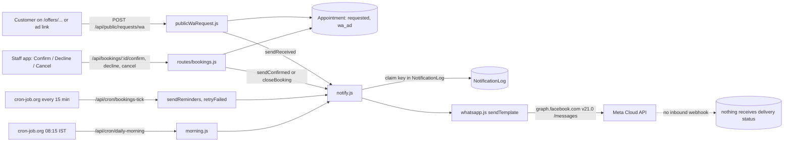
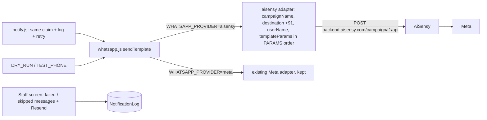

# WhatsApp messaging audit (Phase 1, read-only)

Date: 24 Oct 2026. Branch read: `fix/wa-request-manage-link` (da11d02). Nothing was run, sent or changed. No secret value was read or printed: only variable names.

**What I read:** `backend/utils/{whatsapp,notify,waRequest,morning,otp,sms,booking,bookingAlerts}.js`, `backend/routes/{cron,bookings,publicWaRequest,publicBooking,public,auth}.js`, `backend/models/{NotificationLog,Customer}.js`, `backend/index.js` (mounts and webhook), `backend/.env.example`, `docs/customer-platform/WHATSAPP_TEMPLATES.md`, the customer WhatsApp form, the tests that touch messaging.
**What I could not check:** the real Vercel environment variables, the real Meta/AiSensy dashboards, the cron-job.org dashboard, and whether any message actually reaches a phone today. Anything that depends on those is marked **unverified**.

---

## 1. Executive summary

1. The app does **not** use WATI or AiSensy. WATI was removed (commit 6027e18). Every message goes straight to **Meta's WhatsApp Cloud API** through one file, `utils/whatsapp.js`. The code says "this app never calls AiSensy" (`whatsapp.js:6-9`).
2. The confirmation flow is fully wired in code (request received, confirmed, declined, cancelled, moved, refund, reminders, day sheet), with a sent-once log. So the code is not the blocker.
3. Whether a confirmation reaches a customer today depends on `META_WA_TOKEN`, `META_WA_PHONE_NUMBER_ID` and one `WHATSAPP_TEMPLATE_*` variable per message. **Unverified.** If the salon number now lives on AiSensy, the owner may not have a Meta token for it at all.
4. Biggest trap: if any of those variables is missing when a booking is confirmed, that message is marked `skipped` and is **never retried** (`notify.js:61`, `notify.js:89-92`). Fixing the settings later does not send it.
5. Staff cannot see failed or skipped messages anywhere. `NotificationLog` is written but never read by any route or screen.

---

## 2. Architecture

### Today (as the code works)

### Target (AiSensy)

The target keeps `notify.js` (claim, log, one retry) exactly as is. Only the last hop changes.

---

## 3. Event matrix

Provider for every row: **Meta Cloud API** (live code). Variables are named in `ORDER` (`whatsapp.js:33-48`). `salon_link` is added to every message by `notify.js:65`. Error handling is the same on every row: `notify()` never throws, writes `sent / failed / skipped` to `NotificationLog`, and `bookings-tick` retries `failed` rows once (`notify.js:87-97`).

| Event | Triggered in | Sent today? | Template env var (doc name) | Variables, in order | Recipient |
|---|---|---|---|---|---|
| Customer submits request (offer page / WA ad) | `publicWaRequest.js:223` → `waRequest.js:89` | yes | `REQUEST_RECEIVED` (`request_received_v1`) | name, ref, when (the time asked for), link, salon_link | customer |
| Customer submits paid/engine booking, request-type | `booking.js:482-485` (`afterSettled`) | yes | `REQUEST_RECEIVED` | name, ref, when, link, salon_link | customer |
| Payment settles, instant booking | `booking.js:482-485` | yes | `BOOKING_CONFIRMED` (`booking_confirmed_v1`) | name, ref, when, link, salon_link | customer |
| Staff accepts, WA-ad request | `routes/bookings.js:241` → `waRequest.js:100` | yes | `BOOKING_CONFIRMED` | name, ref, when, link, salon_link | customer |
| Staff accepts, engine request (holds its time) | `bookings.js:174` / `:479` → `approveRequest` → `booking.js:482` | yes | `BOOKING_CONFIRMED` | same | customer |
| Staff accepts, old "request-lite" website request (no time yet) | `bookings.js:239-241` | **no** (comment: "handled by phone") | none | none | none |
| Staff declines a request, WA-ad (unpaid) | `closeBooking` `booking.js:844-847` | yes | `REQUEST_DECLINED` | name, ref, salon_link | customer |
| Staff declines a request, paid | `booking.js:844-847` | yes | `BOOKING_DECLINED` | name, ref, refund, salon_link | customer |
| Staff declines a request-lite (web, no deposit, no time) | `booking.js:838-840` | **no** (`engineBooking` false) | none | none | none |
| Staff or customer cancels confirmed, unpaid WA-ad | `booking.js:844-847` | yes | `REQUEST_CANCELLED` | name, ref, salon_link | customer |
| Staff or customer cancels confirmed, paid | `booking.js:844-847` | yes | `BOOKING_CANCELLED` | name, ref, refund, salon_link | customer |
| Slot moved (staff) | `booking.js:1101` | yes | `BOOKING_MOVED` | name, ref, when, link, salon_link | customer |
| Slot moved (customer reschedule) | `booking.js:1521` | yes | `BOOKING_MOVED` | same | customer |
| Stylist changed (staff move) | `booking.js:1112` | yes, only when the customer named an artist | `BOOKING_ARTIST_CHANGED` (`artist_changed_v1`) | name, ref, when, oldArtist, newArtist, reason, link, salon_link | customer |
| Stylist changed (artist on leave) | `booking.js:1236` | yes, same condition | `BOOKING_ARTIST_CHANGED` | same | customer |
| Refund issued | `booking.js:1371` (`sendRefund`) | yes | `BOOKING_REFUND` | name, ref, amount, salon_link | customer |
| Paid after hold expired (refund queued) | `booking.js:606` | yes | `BOOKING_REFUND` | name, ref, amount, salon_link | customer |
| 24h reminder | `booking.js:718` (via `bookings-tick`) | yes | `REMINDER_24H` (`reminder_24h_v1`) | name, ref, when, link, map, salon_link | customer |
| 2h reminder | `booking.js:722` | yes | `REMINDER_2H` | same | customer |
| Daily artist sheet 08:15 | `morning.js:59` (via `daily-morning`) | yes | `ARTIST_DAY_SHEET` | name, date, count, list | each artist (their own phone) |
| Login OTP, customer booking | `otp.js:34` | yes | `OTP` (authentication template) | code, sent in body and in the button | customer |
| Login OTP, staff approval fallback | `auth.js:589` → `sms.js` | **no**: MSG91 SMS, not configured; falls back to Telegram | none | none | staff |

Notes on the matrix:
- The 2h reminder `ahead <= 2h` has no lower bound, so a confirmed booking that starts in 20 minutes still qualifies if it was booked 3h+ ahead (`booking.js:721`). Fine, it sends once.
- The 24h reminder is skipped for a booking made less than 25 hours ahead (`booking.js:717`). That is intentional and tested (`today-board.test.js:463-468`).
- Time zone: reminder windows use epoch differences, and the visible time is formatted with `timeZone: SALON_TZ` (`bookingAlerts.js:73-77`, `morning.js:33-34`). No server-clock bug found.

---

## 4. Findings

### P0: blocks confirmations or leaks data

**P0-1. A message sent while WhatsApp is unconfigured is lost forever.**
`notify.js:54-61` claims the key before sending. `whatsapp.js:120-129` returns `skipped` when `META_WA_TOKEN`, `META_WA_PHONE_NUMBER_ID` or the template variable is missing. `notify.js:87-92` retries only `failed` and stale `pending` rows, never `skipped`. A repeat call with the same key returns `duplicate`.
Impact: during the Karwa Chauth campaign, every confirmation sent before the settings are right is gone, and fixing the settings does not bring it back.
Smallest fix: let `retryFailed` also pick `skipped` rows younger than, say, 24 hours (and cap attempts). Add one test. About 20 lines.

**P0-2. The provider is probably not what the owner thinks it is. (unverified)**
Code sends to `graph.facebook.com/{phoneNumberId}/messages` with the owner's own Meta token (`whatsapp.js:88-90`). The owner is now on AiSensy and wants to call AiSensy's API. If the number was moved under AiSensy's WhatsApp account, a token from the owner's own Meta app may not be able to send from it.
Impact: all customer messages fail with an API error, and `notify` records `failed`.
Smallest fix: add the AiSensy adapter (Phase 2) behind `WHATSAPP_PROVIDER`. Needs your answer to Question 1.

**P0-3. Template wording and variables do not match what you said is live in AiSensy.**
The code and the doc send `name, ref, ...` (`ORDER`, `whatsapp.js:41-42`). You describe `request_cancelled_v1` as `name, "for <service> on <date, time>", wa.me link`. Code would put the booking reference (for example `EXP-ABCDE`) where your template expects "for Bridal on Sat 25 Oct, 11:00 am". The doc also names `booking_confirmed_v1` and `reminder_24h_v1`, while your live ones are `_v2`, whose variable lists I do not have.
Impact: wrong or confusing text to customers, or an AiSensy rejection when the count differs.
Smallest fix: send the approved template texts (see Questions) and build the `PARAMS` table from them.

**P0-4. No one can see that a confirmation did not go out.**
`NotificationLog` is read only by `notify.js` and `morning.js`; no route or screen shows it (grep across backend and frontend). A `failed` or `skipped` confirmation looks identical to a sent one in the staff app.
Impact: during a campaign, the salon will not know which customers were never told.
Smallest fix: one staff-only `GET /api/bookings/messages?status=failed,skipped` plus a small list with a Resend button. If you want less: show the message status on each booking card.

### P1

**P1-1. The booking timer may not be running. (unverified)**
Reminders, retries and expiry all run from `bookings-tick`, which only cron-job.org calls (`cron.js:176-211`, comment `cron.js:9-14`). My notes say that job returned 404 until Phase 2 was deployed, and cron-job.org disables jobs after repeated failures. Nothing in the repo watches it.
Impact: no reminders and no retries, silently.
Fix: open cron-job.org, confirm the job is enabled and its last result is 200. (No code.)

**P1-2. `daily-morning` is not in the list of timers set up on 14 Oct. (unverified)**
My notes list three jobs: `requests-tick`, health, `bookings-tick`. The artist day sheet needs `GET /api/cron/daily-morning` at 08:15 IST (`cron.js:125-135`).
Impact: artists never get their sheet.
Fix: add the timer with the `Authorization: Bearer <CRON_SECRET>` header.

**P1-3. Request-lite website requests get no WhatsApp at all.**
Accept: `bookings.js:239-241` messages only `wa_ad`. Decline: `booking.js:838-840` needs `startAt` plus a deposit or non-web channel.
Impact: if the old website request form is still used, those customers hear nothing from the system.
Fix: decide whether you still want that form (Question 5). If yes, send `booking_confirmed` and `request_declined` for them too.

**P1-4. No WhatsApp consent field on the offer-request form, and the server rejects unknown fields.**
`publicWaRequest.js:43` lists the only allowed fields and `:49-51` returns 400 for anything else. The form (`WaRequestForm.tsx:117`) sends only `campaign`. The paid booking form does have `whatsappOptIn` (`publicBooking.js:256`).
Impact: you cannot record marketing opt-in from the Karwa Chauth flow. (Transactional messages do not need opt-in under CLAUDE.md, so this affects only later marketing.)
Fix: add an unticked checkbox, add `whatsappOptIn` to `FIELDS`, save to `Customer.marketing`.

**P1-5. Attribution from the Meta ad is not stored for offer requests.**
`publicWaRequest.js:184` hard-codes `utm = {source: "whatsapp", medium: "ad", campaign}`. No `fbclid`, `utm_*` or ad id from the real URL is saved. The paid booking path does save UTM (`publicBooking.js:259-263`, `:337`).
Impact: you can count Karwa Chauth requests, but not tell which ad set produced them.
Fix: pass the existing first-touch UTM from the browser (as `BookingSheet.tsx:342` does), allow `utm` in `FIELDS`, run it through the existing `cleanUtm`.

**P1-6. The "main salon" number is inconsistent.**
`notify.js:25-33` falls back to `919814830307` if Website Settings has no WhatsApp number. The doc samples show `919814830550` and `919988872800`.
Impact: a wrong "talk to us" link in every message if the setting is empty.
Fix: confirm the real number (Question 6) and check the setting is filled.

### P2

**P2-1. Doc drift.** `WHATSAPP_TEMPLATES.md` step 7 tells you to set `WHATSAPP_PROVIDER=meta`; no code reads it. `.env.example` has no such variable.
**P2-2. No number check before sending.** `notify` sends whatever is in `appt.contact`. Customer and WA-request numbers are normalised (`Customer.js:32-37`, `publicWaRequest.js:70-73`). Reminders check the format (`booking.js:689`), but the other 15 notify calls do not. Low risk, because inputs are normalised at the door.
**P2-3. Retry gives up after one more try** (`MAX_ATTEMPTS = 2`, `notify.js:23`). An outage longer than one 15-minute tick loses the message (visible only with P0-4 fixed).
**P2-4. Message errors are logged without the template or HTTP body** for non-JSON failures (`whatsapp.js:101-104`), which matters for AiSensy because its error codes are undocumented.

### Checked and fine
- **Secrets:** no WhatsApp key is in any browser bundle. The only `VITE_*` values are the backend URL and the customer site URL; the customer site has no messaging variables. The Meta token is read only on the server (`whatsapp.js:50-58`).
- **Committed secrets:** only `backend/.env.example`, `customer/.env.example` and `frontend/.env.production` (a URL) are tracked. I found no committed `.env` with values in the history (file names only).
- **Authorisation:** all `/api/bookings/*` routes sit behind `authenticate` (`index.js:850`) and `BOOKINGS_MANAGE` / `BOOKINGS_REFUND` permission checks. The offer-request endpoint is public by design with a honeypot, 10 per IP per hour, 3 per phone per day (`publicWaRequest.js:45`, `:168`). Cron routes need `CRON_SECRET` with a constant-time compare (`cron.js:46-52`).
- **Duplicates:** a unique `NotificationLog.key` per booking and event (`NotificationLog.js:17`) means a double click, refresh or webhook plus browser produces one message. Tests cover idempotent reminders (`today-board.test.js:463-468`) and the Meta payload (`whatsapp-meta.test.js`).
- **Awaiting:** sends are awaited before the response on the paths I read (`publicWaRequest.js:223`, `bookings.js:241`). Suits Vercel.
- **Inbound webhook:** none exists for WhatsApp (the only webhooks are Razorpay and Telegram). So there is no signature to check, and also no delivery status or customer-reply handling. With Meta direct, `sent` means "Meta accepted it", not "delivered".

---

## 5. Gap list against AiSensy

The AiSensy adapter does not exist in the repo. Every row below needs the same missing piece: `WHATSAPP_PROVIDER=aisensy`, an adapter inside `whatsapp.js`, and a `PARAMS` table. Extra gaps are in the last column.

| Event | AiSensy campaign you listed | Code variables today | Extra gap |
|---|---|---|---|
| Request received | `request_received` (`_v1`) | name, ref, when, link, salon_link | Need the template text to confirm the order |
| Booking confirmed | `booking_confirmed` (`_v2`) | name, ref, when, link, salon_link (5) | `_v2` variable list unknown |
| Booking declined | `booking_declined` | name, ref, refund, salon_link | Doc template prints `₹{{3}}`; code sends a bare number |
| Request declined | `request_declined` | name, ref, salon_link | Confirm {{2}} is the ref or a description |
| Booking cancelled | `booking_cancelled` | name, ref, refund, salon_link | Same refund format check |
| Request cancelled | `request_cancelled` | name, ref, salon_link | **Mismatch**: your {{2}} is "for <service> on <date, time>" (P0-3). Code has no such value; it would need service names and a formatted time |
| Refund | `booking_refund` | name, ref, amount, salon_link | none |
| Moved | `booking_moved` | name, ref, when, link, salon_link | Campaign exists but is it Live? |
| Artist changed | `artist_changed` | 8 variables (ORDER `booking_artist_changed`) | Campaign name differs from the code's message type; map it |
| 24h reminder | `reminder_24h` (`_v2`) | name, ref, when, link, map, salon_link | `_v2` list unknown |
| 2h reminder | `reminder_2h` | same 6 | Confirm count |
| Artist day sheet | `artist_day_sheet` | name, date, count, list | Recipient is the artist; each artist needs a valid `phone` on their profile (`morning.js:54-58`) |
| OTP | `otp_code` | code, plus button parameter | AiSensy's API may not accept authentication-template button codes. Needs a test with your account |

Also missing for AiSensy: `+91` prefix (code sends `91XXXXXXXXXX`, `whatsapp.js:93`), `userName`, the 10-rupee minimum balance check (surface as a clear error), and `DRY_RUN` / `TEST_PHONE` (neither exists today).

---

## 6. Open questions for you

1. **Which setup is really live for the salon number?** Is it still registered with Meta directly, or is it now only under AiSensy? Do you have a Meta token for it? (Decides P0-2.)
2. **Paste the exact text of every approved template**, with the `{{n}}` positions. Most urgent: `request_cancelled_v1`, `booking_confirmed_v2`, `reminder_24h_v2`, `request_declined_v1`, `request_received_v1`. (The repo's own doc has `_v1` texts that may be out of date.)
3. **Staff action to event:** is it right that Confirm → `booking_confirmed`, Decline on a request → `request_declined`, Cancel on a confirmed booking → `request_cancelled` (unpaid) or `booking_cancelled` (paid)?
4. **Who receives `artist_day_sheet`?** Today: each artist with bookings that day, at their own profile phone. Should the owner or reception also get a copy?
5. **Is the old "request-lite" website form still in use?** If yes, those customers currently get no WhatsApp (P1-3).
6. **What is the real main salon WhatsApp number** for the "talk to us" link? (P1-6)
7. **`otp_code` over AiSensy:** do you want customer OTP on AiSensy, or keep it out of this change until you have tested whether the API accepts it?
8. **Is the 15-minute timer on cron-job.org enabled and green?** And do you want me to list the `daily-morning` timer for you to add?
9. **Retry window:** if a message was skipped or failed, how long should we keep trying before giving up (suggest 24 hours)?

---

## 7. Proposed Phase 2 plan

Smaller than your brief assumed, because the repo already has one door (`whatsapp.js`) and a sent-once log (`notify.js`). No new `lib/whatsapp.ts`; this backend is CommonJS. All paths are in `backend/`.

| # | Change | Files | Effort |
|---|---|---|---|
| 1 | AiSensy adapter: build the JSON, `+91` phone, `userName`, one retry on network error, log status and body (never the key). Select with `WHATSAPP_PROVIDER` (`meta` default, `aisensy`). Old Meta adapter stays behind the flag. | `utils/whatsapp.js` | 2-3 h |
| 2 | `PARAMS` table per campaign: type to campaign name and ordered variable list, validated (no empty value, no line break, count matches). Built from the template texts you send. | `utils/whatsapp.js` | 1 h, after Question 2 |
| 3 | `DRY_RUN` (log and record `skipped:dry_run`, send nothing) and `TEST_PHONE` (redirect every send to that number). Both default to the safe setting in `.env.example`. | `utils/whatsapp.js`, `.env.example` | 1 h |
| 4 | Fix P0-1: `retryFailed` also re-sends `skipped` rows (not `dry_run`) for 24 h; raise attempts. | `utils/notify.js` | 1 h + tests |
| 5 | Staff list of failed/skipped messages with Resend (P0-4). | `routes/bookings.js`, `frontend/src/pages/dashboard/BookingRequests.tsx` | 3-4 h |
| 6 | Opt-in checkbox and real UTM on the offer-request form (P1-4, P1-5). | `routes/publicWaRequest.js`, `customer/components/offers/WaRequestForm.tsx` | 2 h |
| 7 | Tests: params order and count per campaign, phone formatting, skipped-then-resent, dry-run, TEST_PHONE override. Reminder window and idempotency tests already exist. | `test/whatsapp-aisensy.test.js`, `test/notify.test.js` | 2-3 h |
| 8 | Docs: update `WHATSAPP_TEMPLATES.md` (provider, `_v2` names, variable orders) and the Decisions table. | `docs/customer-platform/*` | 1 h |
| 9 | Your manual tasks: check the cron-job.org timers, add `AISENSY_KEY`, `WHATSAPP_PROVIDER`, `DRY_RUN`, `TEST_PHONE` on the backend Vercel project, redeploy backend. | Vercel, cron-job.org | 30 min |

Order: 2 and 1 first (they need your template texts), then 3, 4, 7. Items 5 and 6 can follow after the campaign starts if time is short. Keep `DRY_RUN=true` until you have seen one test message per template on your own phone.

**Stopping here, waiting for your approval.**
